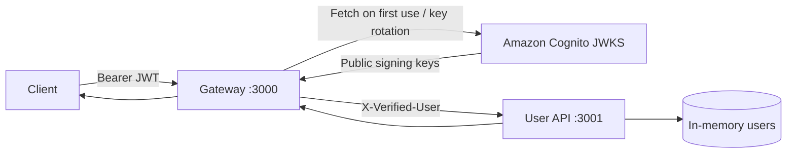

# TypeScript API Gateway Demo

Two small Node.js services demonstrate a clean trust boundary with Amazon Cognito:

- **Gateway** verifies JWT signature, expiration, issuer, and audience against Cognito's cached JWKS, then proxies `/api/users` with a trusted `X-Verified-User` header.
- **User API** implements in-memory CRUD. It does not parse JWTs and rejects requests without `X-Verified-User` with `403 Forbidden`.

## Traffic flow



The gateway removes any client-supplied `X-Verified-User` before adding the verified identity. In a deployment, keep the User API on a private network so clients cannot bypass the gateway and forge that header.

## Project layout

```text
services/
├── gateway/
│   └── src/
│       ├── infrastructure/auth/  # Cognito and JWKS integration
│       └── interfaces/http/      # Authentication and logging middleware
└── user-api/
    └── src/
        ├── domain/               # User model
        ├── application/          # Use cases and repository contract
        ├── infrastructure/       # In-memory repository
        └── interfaces/http/      # Express routes and trusted-header policy
infrastructure/
├── bin/                          # CDK application entry point
├── lib/                          # Cognito identity stack
└── test/                         # CloudFormation assertion tests
```

## Cognito setup

The CDK identity stack creates only the Cognito resources:

- An email-based User Pool retained if the stack is deleted
- A public App Client without a secret
- Authorization-code flow suitable for PKCE
- `USER_PASSWORD_AUTH` for the local AWS CLI example
- A Cognito Hosted UI domain
- Issuer, audience, User Pool ID, and Hosted UI outputs

Authenticate the AWS CLI, then bootstrap CDK once for the account in Sydney. Replace the account ID and choose a globally unique lowercase domain prefix:

```bash
export AWS_REGION=ap-southeast-2
export AWS_ACCOUNT_ID=$(aws sts get-caller-identity --query Account --output text)

npm run cdk:bootstrap -- -c domainPrefix=demo-secure-api "aws://$AWS_ACCOUNT_ID/$AWS_REGION"
npm run cdk:diff -- -c domainPrefix=demo-secure-api
npm run cdk:deploy -- -c domainPrefix=demo-secure-api
```

Additional comma-separated callback and logout URLs can be supplied when needed:

```bash
npm run cdk:deploy -- \
  -c domainPrefix=demo-secure-api \
  -c callbackUrls=http://localhost:3000/callback,https://example.com/callback \
  -c logoutUrls=http://localhost:3000,https://example.com
```

After deployment, read the outputs and place them in `.env`:

```bash
export COGNITO_ISSUER=$(aws cloudformation describe-stacks \
  --region ap-southeast-2 \
  --stack-name DemoApiIdentityStack \
  --query "Stacks[0].Outputs[?OutputKey=='CognitoIssuer'].OutputValue | [0]" \
  --output text)

export COGNITO_AUDIENCE=$(aws cloudformation describe-stacks \
  --region ap-southeast-2 \
  --stack-name DemoApiIdentityStack \
  --query "Stacks[0].Outputs[?OutputKey=='CognitoAudience'].OutputValue | [0]" \
  --output text)
```

Create a test user in the deployed User Pool and set a permanent password. Then copy the environment template and replace its issuer and audience placeholders with these output values:

```bash
cp .env.example .env
```

```dotenv
NODE_ENV=development
LOG_LEVEL=info
TRUST_PROXY_HOPS=0
GATEWAY_PORT=3000
BACKEND_URL=http://127.0.0.1:3001
COGNITO_ISSUER=https://cognito-idp.ap-southeast-2.amazonaws.com/ap-southeast-2_EXAMPLE
COGNITO_AUDIENCE=your-cognito-app-client-id
USER_API_PORT=3001
```

`COGNITO_AUDIENCE` is the App client ID and must match the token's `aud` claim. The JWKS URL is derived from the issuer. `COGNITO_JWKS_URI` is available only when an explicit override is needed.

The stack is pinned to `ap-southeast-2`. The User Pool uses a retain policy, so deleting the CDK stack does not delete user identities. Delete the retained pool manually only when its data is no longer required.

## Run locally

Node.js 20 or newer is required.

```bash
npm install
npm run dev
```

The gateway starts on `http://localhost:3000`; the User API starts on `http://localhost:3001`. Data is intentionally lost whenever the User API restarts.

For a production-style build:

```bash
npm run build
npm run start:backend
npm run start:gateway
```

## Get a test token

With the AWS CLI configured, request a Cognito ID token. Enter credentials in your shell rather than storing passwords in `.env`:

```bash
export AWS_REGION=ap-southeast-2
export COGNITO_CLIENT_ID=your-cognito-app-client-id
export COGNITO_USERNAME=your-test-username
read -s -p 'Cognito password: ' COGNITO_PASSWORD && echo

export ID_TOKEN=$(aws cognito-idp initiate-auth \
  --region "$AWS_REGION" \
  --client-id "$COGNITO_CLIENT_ID" \
  --auth-flow USER_PASSWORD_AUTH \
  --auth-parameters "USERNAME=$COGNITO_USERNAME,PASSWORD=$COGNITO_PASSWORD" \
  --query 'AuthenticationResult.IdToken' \
  --output text)
unset COGNITO_PASSWORD
```

For a hosted UI or authorization-code flow, assign its returned ID token to `ID_TOKEN` instead.

## Test the scenarios

Success through the gateway:

```bash
curl -i http://localhost:3000/api/users \
  -H "Authorization: Bearer $ID_TOKEN"

curl -i -X POST http://localhost:3000/api/users \
  -H "Authorization: Bearer $ID_TOKEN" \
  -H 'Content-Type: application/json' \
  -d '{"name":"Ada Lovelace","email":"ada@example.com"}'
```

Missing and invalid tokens return `401` without contacting the backend:

```bash
curl -i http://localhost:3000/api/users
curl -i http://localhost:3000/api/users -H 'Authorization: Bearer invalid-token'
```

Calling the backend directly without the trusted header returns `403`:

```bash
curl -i http://localhost:3001/api/users
```

Invalid input returns `400` without a stack trace:

```bash
curl -i -X POST http://localhost:3000/api/users \
  -H "Authorization: Bearer $ID_TOKEN" \
  -H 'Content-Type: application/json' \
  -d '{"name":"","email":"invalid"}'
```

## Development commands

| Command                                     | Purpose                                           |
| ------------------------------------------- | ------------------------------------------------- |
| `npm run dev`                               | Run both services with TypeScript watch mode      |
| `npm run dev:pretty`                        | Run both services with readable local logs        |
| `npm test`                                  | Run gateway and User API tests                    |
| `npm run lint`                              | Run type-aware ESLint rules                       |
| `npm run format`                            | Format the repository with Prettier               |
| `npm run typecheck`                         | Check strict TypeScript without emitting files    |
| `npm run build`                             | Compile both services to `dist/`                  |
| `npm run cdk:synth -- -c domainPrefix=...`  | Synthesize the identity stack                     |
| `npm run cdk:diff -- -c domainPrefix=...`   | Preview identity changes                          |
| `npm run cdk:deploy -- -c domainPrefix=...` | Deploy Cognito to Sydney                          |
| `npm run validate`                          | Run formatting, linting, types, tests, and builds |

## Logging and tracing

Production logs are newline-delimited JSON with ISO timestamps, service and environment names, request ID, W3C trace ID and span ID, method, path, source IP, status, duration, and the verified user ID when available. Authorization and token fields are redacted; request bodies are never logged.

The gateway validates or creates `X-Request-ID` and W3C `traceparent` headers, returns them to the client, and propagates them to the User API with a new downstream span ID. Use either value to correlate one request across both services:

```bash
curl -i http://localhost:3000/api/users \
  -H "Authorization: Bearer $ID_TOKEN" \
  -H 'X-Request-ID: local-debug-123'
```

Set `LOG_LEVEL=debug` for additional diagnostics and use `npm run dev:pretty` for human-readable local output. Keep JSON output with `npm run dev` when logs are being collected. Set `TRUST_PROXY_HOPS` only to the known number of proxies in front of each service so source IP logging cannot be spoofed.

Both services handle `SIGINT` and `SIGTERM` with a ten-second graceful shutdown window. Uncaught exceptions, unhandled rejections, HTTP server errors, proxy failures, malformed JSON, rejected authentication, and aborted requests are logged with request context where available. Stack traces remain server-side and are never returned to clients.
