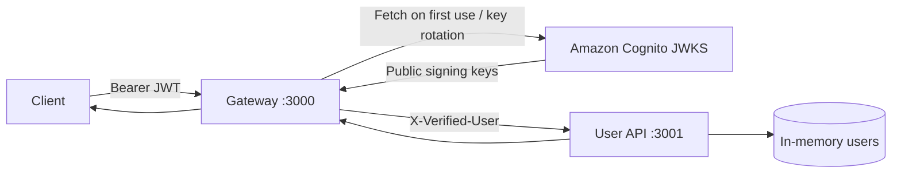

# TypeScript API Gateway Demo

Two small Node.js services demonstrate a clean trust boundary with Amazon Cognito:

- **Gateway** verifies Cognito access-token signature, expiration, issuer, token use, client ID, and method-specific scopes against Cognito's cached JWKS, then proxies `/api/users` with a trusted `X-Verified-User` header.
- **User API** implements in-memory CRUD. It does not parse JWTs and rejects requests without `X-Verified-User` with `403 Forbidden`.

## Traffic flow



The gateway removes any client-supplied `X-Verified-User` before adding the verified identity. In a deployment, keep the User API on a private network so clients cannot bypass the gateway and forge that header.

## Project layout

```text
services/
├── gateway/
│   └── src/
│       ├── infrastructure/auth/  # Cognito and JWKS integration
│       └── interfaces/http/      # Authentication and logging middleware
└── user-api/
    └── src/
        ├── domain/               # User model
        ├── application/          # Use cases and repository contract
        ├── infrastructure/       # In-memory repository
        └── interfaces/http/      # Express routes and trusted-header policy
infrastructure/
├── bin/                          # CDK application entry point
├── lib/                          # Cognito identity stack
└── test/                         # CloudFormation assertion tests
```

## Cognito setup

The CDK identity stack creates only the Cognito resources:

- An email-based User Pool retained if the stack is deleted
- A public App Client without a secret
- Authorization-code flow suitable for PKCE
- `users.read` and `users.write` API scopes
- A Cognito Hosted UI domain
- Issuer, App Client ID, User Pool ID, and Hosted UI outputs

Authenticate the AWS CLI, then bootstrap CDK once for the account in Sydney. Replace the account ID and choose a globally unique lowercase domain prefix:

```bash
export AWS_REGION=ap-southeast-2
export AWS_ACCOUNT_ID=$(aws sts get-caller-identity --query Account --output text)

npm run cdk:bootstrap -- -c domainPrefix=demo-secure-api "aws://$AWS_ACCOUNT_ID/$AWS_REGION"
npm run cdk:diff -- -c domainPrefix=demo-secure-api
npm run cdk:deploy -- -c domainPrefix=demo-secure-api
```

Additional comma-separated callback and logout URLs can be supplied when needed:

```bash
npm run cdk:deploy -- \
  -c domainPrefix=demo-secure-api \
  -c callbackUrls=http://localhost:3000/callback,https://example.com/callback \
  -c logoutUrls=http://localhost:3000,https://example.com
```

After deployment, read the outputs and place them in `.env`:

```bash
export COGNITO_ISSUER=$(aws cloudformation describe-stacks \
  --region ap-southeast-2 \
  --stack-name DemoApiIdentityStack \
  --query "Stacks[0].Outputs[?OutputKey=='CognitoIssuer'].OutputValue | [0]" \
  --output text)

export COGNITO_CLIENT_ID=$(aws cloudformation describe-stacks \
  --region ap-southeast-2 \
  --stack-name DemoApiIdentityStack \
  --query "Stacks[0].Outputs[?OutputKey=='CognitoClientId'].OutputValue | [0]" \
  --output text)

export COGNITO_HOSTED_UI_URL=$(aws cloudformation describe-stacks \
  --region ap-southeast-2 \
  --stack-name DemoApiIdentityStack \
  --query "Stacks[0].Outputs[?OutputKey=='HostedUiBaseUrl'].OutputValue | [0]" \
  --output text)
```

Create a test user in the deployed User Pool and set a permanent password. Then copy the environment template and replace its Cognito placeholders with these output values:

```bash
cp .env.example .env
```

```dotenv
NODE_ENV=development
LOG_LEVEL=info
TRUST_PROXY_HOPS=0
GATEWAY_PORT=3000
BACKEND_URL=http://127.0.0.1:3001
COGNITO_ISSUER=https://cognito-idp.ap-southeast-2.amazonaws.com/ap-southeast-2_EXAMPLE
COGNITO_CLIENT_ID=your-cognito-app-client-id
COGNITO_HOSTED_UI_URL=https://your-domain.auth.ap-southeast-2.amazoncognito.com
COGNITO_READ_SCOPE=demo-api/users.read
COGNITO_WRITE_SCOPE=demo-api/users.write
USER_API_PORT=3001
```

`COGNITO_CLIENT_ID` must match the access token's `client_id` claim. For Cognito user access tokens, `client_id` identifies the intended app client and is the audience check; unlike ID tokens, these tokens do not normally carry the app client in `aud`. The gateway requires `users.read` for `GET` and `HEAD`, and `users.write` for mutations. The JWKS URL is derived from the issuer. `COGNITO_JWKS_URI` is available only when an explicit override is needed.

The stack is pinned to `ap-southeast-2`. The User Pool uses a retain policy, so deleting the CDK stack does not delete user identities. Delete the retained pool manually only when its data is no longer required.

## Run locally

Node.js 20 or newer is required.

```bash
npm install
npm run dev
```

The gateway starts on `http://localhost:3000`; the User API starts on `http://localhost:3001`. Data is intentionally lost whenever the User API restarts.

To run just one service, use its workspace from the repository root:

```bash
npm run dev --workspace @demo/gateway
npm run dev --workspace @demo/user-api
```

To start both services with the Node.js inspector and automatic restarts, run:

```bash
npm run debug
```

The gateway listens for a debugger on port `9230`, and the User API listens on
port `9231`. Use `npm run debug:gateway` or `npm run debug:backend` to debug one
service from a terminal.

For VS Code, open `demo-api-gateway.code-workspace`, select **Run and Debug**,
and launch **Debug Gateway**, **Debug User API**, or **Debug All Services**.
These profiles load the root `.env` file and support breakpoints directly in
the TypeScript source. Copy `.env.example` to `.env` before debugging if it
does not already exist.

For a production-style build, build once, then start each service in a separate terminal:

```bash
npm run build
npm run start:backend
```

In another terminal, start the gateway:

```bash
npm run start:gateway
```

## Get a test token

Request a scoped access token with Cognito's Authorization Code + PKCE flow. The helper reads `COGNITO_CLIENT_ID`, `COGNITO_HOSTED_UI_URL`, and optional `COGNITO_REDIRECT_URI` and `COGNITO_OAUTH_SCOPES` from the root `.env` file (or the environment). It opens the Hosted UI when possible and asks for the complete callback URL after sign-in. It requires `curl`, `node`, `openssl`, and an interactive terminal:

```bash
export ACCESS_TOKEN=$(npm run --silent test:cognito-token)
```

Yes, the callback URL is needed for this Authorization Code + PKCE flow. Cognito redirects there after sign-in with a temporary authorization code and `state`; the helper reads those values from the full URL and exchanges the code for an access token. The redirect URI must match one registered in the Cognito App Client exactly. The default is `http://localhost:3000/callback`; set `COGNITO_REDIRECT_URI` in `.env` if you registered a different callback. The callback page may show `404` because the gateway does not serve a callback page: copy its full address, including `code` and `state`, into the helper prompt. On success, the helper prints a confirmation to stderr and outputs only the access token to stdout, so command substitution remains usable.

## Test the scenarios

Start both services, then run the user CRUD lifecycle (`GET /api/users`, `GET /api/users/:id`, `POST`, `PUT`, and `DELETE`) along with authentication, authorization, trust-boundary, and validation scenarios. The CRUD checks create a user, verify it appears in the list, fetch and update it, then delete it. If `ACCESS_TOKEN` is unset, the script runs the PKCE flow above. If it is set, the script reuses that token:

```bash
npm run test:scenarios
```

Set `GATEWAY_URL` or `BACKEND_URL` to the service base URL to test non-default endpoints; the script appends `/api/users`. The runner exits immediately if a response has an unexpected status.

## Development commands

| Command                                                               | Purpose                                           |
| --------------------------------------------------------------------- | ------------------------------------------------- |
| `npm run dev`                                                         | Run both services with TypeScript watch mode      |
| `npm run dev:pretty`                                                  | Run both services with readable local logs        |
| `npm run debug`                                                       | Debug both services with Node inspector and watch |
| `npm run debug:gateway`                                               | Debug the gateway on inspector port 9230          |
| `npm run debug:backend`                                               | Debug the User API on inspector port 9231         |
| `npm run build`                                                       | Compile all services and infrastructure           |
| `npm run start:backend`                                               | Start the built User API                          |
| `npm run start:gateway`                                               | Start the built gateway                           |
| `npm test`                                                            | Run gateway and User API tests                    |
| `npm test --workspace @demo/gateway`                                  | Run only the gateway tests                        |
| `npm test --workspace @demo/user-api`                                 | Run only the User API tests                       |
| `npm run test:cognito-token`                                          | Request a scoped Cognito access token with PKCE   |
| `npm run test:scenarios`                                              | Run the live authentication scenarios             |
| `npm run lint`                                                        | Run type-aware ESLint rules                       |
| `npm run format`                                                      | Format the repository with Prettier               |
| `npm run format:check`                                                | Check formatting without changing files           |
| `npm run typecheck`                                                   | Check strict TypeScript without emitting files    |
| `npm run cdk:bootstrap -- -c domainPrefix=... "aws://ACCOUNT/REGION"` | Bootstrap CDK for the AWS account and region      |
| `npm run cdk:synth -- -c domainPrefix=...`                            | Synthesize the identity stack                     |
| `npm run cdk:diff -- -c domainPrefix=...`                             | Preview identity changes                          |
| `npm run cdk:deploy -- -c domainPrefix=...`                           | Deploy Cognito to Sydney                          |
| `npm run cdk:destroy -- -c domainPrefix=...`                          | Delete the CDK stack                              |
| `npm run validate`                                                    | Run formatting, linting, types, tests, and builds |

Run commands from the repository root. For CDK commands, put `--` after the npm script name to pass options through to CDK; use the same `domainPrefix` supplied when deploying. For example, after setting `AWS_REGION` and `AWS_ACCOUNT_ID`, bootstrap CDK once with:

```bash
npm run cdk:bootstrap -- -c domainPrefix=demo-secure-api "aws://$AWS_ACCOUNT_ID/$AWS_REGION"
```

`npm run cdk:destroy` deletes the stack, but the retained Cognito User Pool is not deleted with it. Use `npm run validate` before submitting changes; it runs the formatting check, lint, type checks, tests, and builds in sequence.

## Gateway security boundaries

The gateway handles each concern in a separate stage:

1. **Authentication** validates the Cognito signature and issuer, requires an unexpired access token, checks the App Client ID, and establishes the authenticated identity.
2. **Authorization** independently selects the required read or write scope from the HTTP method and rejects authenticated callers that lack it.
3. **Proxying** runs only after both checks pass. It removes client-supplied identity data and forwards only the verified user, tracing headers, and required HTTP content headers. Client authorization and cookie headers are never sent to the User API.

Authentication failures return only `401 Unauthorized`, authorization failures return only `403 Forbidden`, and unexpected failures return generic `500` or `502` responses. Detailed diagnostics remain in server logs. Rejected tokens, verifier error messages, request bodies, cookie values, and query-string values are not logged.

## Logging and tracing

Production logs are newline-delimited JSON with ISO timestamps, service and environment names, request ID, W3C trace ID and span ID, method, path without its query string, source IP, status, duration, and the verified user ID when available. Authorization and token fields are redacted; request bodies are never logged.

The gateway validates or creates `X-Request-ID` and W3C `traceparent` headers, returns them to the client, and propagates them to the User API with a new downstream span ID. Use either value to correlate one request across both services:

```bash
curl -i http://localhost:3000/api/users \
  -H "Authorization: Bearer $ACCESS_TOKEN" \
  -H 'X-Request-ID: local-debug-123'
```

Set `LOG_LEVEL=debug` for additional diagnostics and use `npm run dev:pretty` for human-readable local output. Keep JSON output with `npm run dev` when logs are being collected. Set `TRUST_PROXY_HOPS` only to the known number of proxies in front of each service so source IP logging cannot be spoofed.

Both services handle `SIGINT` and `SIGTERM` with a ten-second graceful shutdown window. Uncaught exceptions, unhandled rejections, HTTP server errors, proxy failures, malformed JSON, rejected authentication, and aborted requests are logged with request context where available. Stack traces remain server-side and are never returned to clients.
